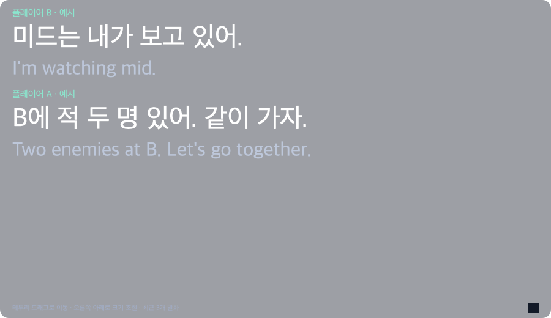

# Voice Caption · v0.2.0

게임·디스코드 음성을 CPU로 인식하고 번역 자막을 띄우는 개인용 데스크톱 앱입니다. **Windows 10/11 x64 지원을 목표로 하는 개발 프로토타입**이며, 실제 Windows 오디오·게임 및 패키징된 EXE는 아직 검증하지 않았습니다.

**[친구용 사용 설명서 — 처음 사용하는 분은 여기부터](docs/친구용-사용설명서.md)**

[더블클릭해서 읽는 HTML 설명서](docs/친구용-사용설명서.html) · [제작자용 설치·빌드 설명서](read.md) · [검증 기록](docs/VALIDATION.md)

GitHub 저장소: https://github.com/QmdQkdQHd/voice-caption (공개). 친구에게는 Windows에서 빌드를 완료한 실행 파일 ZIP을 따로 전달하세요. 현재 소스 ZIP만으로는 더블클릭해서 사용할 수 없습니다.

## 현재 제공되는 파일

| 파일 | 용도 |
|---|---|
| `release/VoiceCaption-0.2.0-source.zip` | 소스·문서·테스트·Windows 빌드 스크립트. EXE 없음 |
| `build-windows.cmd` | Windows에서 실행 파일 폴더와 ZIP 만들기 |
| `install-windows.cmd` | Python 소스 실행용 환경 설치 |
| `start-windows.cmd` | 소스 버전 실행 |

Windows 실행 파일은 Windows PC에서 `build-windows.cmd`가 성공하면 `release/VoiceCaption-0.2.0-windows-x64.zip`으로 생성됩니다. Mac에서 Windows용 EXE를 빌드했다고 주장하지 않습니다.

## 주요 기능

- GPU 없이 CPU 음성 인식 + 로컬 번역, 선택적 DeepL 대체 번역
- 무음 기준 발화 분할, 음성 인식과 번역 대기 분리
- 최근 세 발화를 유지하는 자막, 문장 길이에 따른 표시 시간
- 위치·크기·폰트·색상·배경 불투명도·클릭 통과 조절
- 별도 음성 처리 프로세스와 중지 시 정리, 독립 오류 표시
- 사용자 지정 화면 영역과 색상을 사용하는 실험적 화자 이름 OCR



## 빠르게 시작하기

### 소스로 실행

Windows에 Python 3.11 x64를 설치한 뒤:

1. `install-windows.cmd` 실행
2. `start-windows.cmd` 실행
3. 원문·번역 언어 선택 → **모델 준비**
4. 실제 출력 장치의 `[PC 소리]` 선택 → **시작**

### 실행 파일 만들기

Windows에서 `build-windows.cmd`를 실행합니다. 설치·테스트·번들 검사까지 성공하면 ZIP이 생성됩니다. 완성된 ZIP 사용자는 Python을 별도로 설치하지 않도록 구성했습니다. `_internal`을 포함한 폴더 전체가 필요합니다. 모델과 선택적 Tesseract는 별도로 준비합니다.

## 알아둘 제한

현재 캡처는 앱별이 아닌 **출력 장치별**입니다. 같은 장치의 효과음과 음악도 포함됩니다. 화자 인식은 화면 기반 추정이며 정확도를 보장하지 않습니다. CPU별 실제 지연과 게임 성능 영향은 아직 측정하지 않았습니다. 단축키·트레이·다운로드 취소는 미구현입니다.

## 테스트

```powershell
python -m unittest discover -s tests -v
python -m compileall -q voice_caption tests scripts packaging
```

UI 검사는 프로젝트와 PySide6를 설치한 환경에서 `python tests/check_ui.py`로 실행합니다. 현재 Mac에서 로직·프로세스·UI 검사를 수행했으며 실제 Windows 통합 검증과는 구분합니다.

## 문서와 공개

설정값, API 키, OCR 설치, 성능 조정, 패키징 구조, 해시 확인, 문제 해결 및 삭제 방법은 **[read.md](read.md)**에 정리했습니다.

개인용 GitHub 저장소에서 소스를 관리합니다. 실행 파일 릴리스는 아직 없습니다. 사용자 코드의 공개 라이선스는 아직 지정하지 않았으며, 포함되는 의존 패키지와 모델에는 각각의 라이선스가 적용됩니다.
