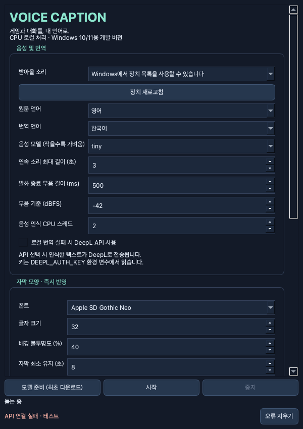
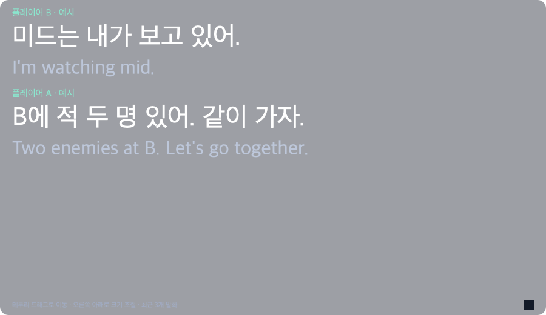

# Voice Caption — 처음 사용하는 친구를 위한 설명서

대상 버전: **0.2.0** · 설명서 작성일: **2026년 11월 16일** · 최종 검토일: **2026년 11월 17일**

Voice Caption은 컴퓨터에서 들리는 외국어 음성을 받아 한국어 같은 원하는 언어로 번역하고, 화면 위에 자막으로 보여 주는 프로그램입니다. 코드를 읽거나 명령어를 입력할 줄 몰라도, 제작자가 준비한 Windows용 실행 파일을 받으면 아래 순서로 사용할 수 있도록 구성했습니다.

> **현재 상태를 먼저 확인해 주세요.**
>
> 이 설명서는 **제작자가 Windows용 실행 파일을 만든 뒤 전달하는 경우**를 기준으로 합니다. 최종 검토 시점에는 소스 코드와 빌드 스크립트만 준비되어 있고, Windows용 실행 파일 제작과 실제 게임 동작은 아직 검증하지 않았습니다. `source.zip`만 받았다면 아직 바로 사용할 파일을 받은 것이 아닙니다. 아래의 실행 파일 ZIP을 제작자에게 요청하세요.

## 먼저 기억할 세 가지

1. 받을 파일은 이름에 **`windows-x64.zip`**이 들어간 ZIP입니다. **`source.zip`은 개발용 파일**입니다.
2. 처음 한 번은 인터넷에 연결하고 **모델 준비 (최초 다운로드)**를 눌러야 합니다.
3. 시작할 때 **내가 게임·통화 소리를 듣는 헤드셋이나 스피커**를 선택해야 합니다.

처음에는 **DeepL API와 화면 화자 인식은 끈 상태**로 시작하세요. 두 기능 없이도 기본 음성 번역을 사용할 수 있게 만들었습니다.

## 목차

- [1. 받을 파일과 준비물 확인](#1-받을-파일과-준비물-확인)
- [2. ZIP 파일 압축 풀기](#2-zip-파일-압축-풀기)
- [3. 프로그램 처음 열기](#3-프로그램-처음-열기)
- [4. 번역 언어와 모델 준비하기](#4-번역-언어와-모델-준비하기)
- [5. 어떤 소리를 번역할지 선택하기](#5-어떤-소리를-번역할지-선택하기)
- [6. 게임을 켜기 전에 번역 확인하기](#6-게임을-켜기-전에-번역-확인하기)
- [7. 자막을 보기 편하게 꾸미기](#7-자막을-보기-편하게-꾸미기)
- [8. 디스코드·게임과 함께 사용하기](#8-디스코드게임과-함께-사용하기)
- [9. 중지·종료하고 다음에 다시 사용하기](#9-중지종료하고-다음에-다시-사용하기)
- [10. 문제가 생겼을 때](#10-문제가-생겼을-때)
- [11. 익숙해진 다음 사용할 선택 기능](#11-익숙해진-다음-사용할-선택-기능)
- [12. 업데이트·삭제와 개인정보](#12-업데이트삭제와-개인정보)
- [13. 제작자에게 도움 요청하기](#13-제작자에게-도움-요청하기)

## 1. 받을 파일과 준비물 확인

### 준비물

- Windows 10 또는 Windows 11이 설치된 **64비트 PC**
- 소리를 들을 헤드셋, 이어폰 또는 스피커
- 최초 모델 다운로드를 위한 인터넷 연결
- 제작자가 빌드하고 확인한 Windows용 프로그램 ZIP

전용 그래픽카드 없이 CPU로 동작하게 설계했습니다. 다만 컴퓨터 성능에 따라 번역이 늦어질 수 있고 게임 성능에도 영향을 줄 수 있습니다. 오래된 PC에서도 일정한 속도로 동작한다고 보장할 수는 없습니다.

### 파일 이름으로 구분하기

| 받은 파일 | 무엇인가요? | 어떻게 하나요? |
|---|---|---|
| `VoiceCaption-0.2.0-windows-x64.zip` | Windows 실행 파일을 담는 패키지 이름 | 아래 설명대로 압축을 풀고 사용합니다. 제작자의 빌드 완료 여부를 확인하세요. |
| `VoiceCaption-0.2.0-source.zip` | 개발자가 수정·빌드할 소스 코드 | 제작자에게 **실행 파일 ZIP**을 요청합니다. |
| `VoiceCaption.exe` 하나만 있음 | 필요한 파일이 빠졌을 수 있음 | `_internal` 폴더를 포함한 **전체 ZIP**을 요청합니다. |
| `.zip.sha256`으로 끝남 | 다운로드 무결성 확인용 정보 | 프로그램 실행 파일이 아닙니다. 처음 사용할 때 직접 열 필요는 없습니다. |

**친구분은 Python 설치, 코드 수정, `build-windows.cmd` 실행을 직접 할 필요가 없는 방식으로 전달받는 것이 기본입니다.** 실행 파일을 만드는 작업은 제작자가 맡습니다.

GitHub의 **Code → Download ZIP**으로 받은 파일은 보통 소스 코드입니다. 이것을 실행 파일 패키지와 혼동하지 마세요. 저장소 링크가 열리지 않으면 제작자에게 파일을 직접 받아도 됩니다.

## 2. ZIP 파일 압축 풀기

ZIP은 여러 파일을 하나로 묶어 놓은 파일입니다. ZIP 안을 열어 보는 것과 실제로 압축을 푸는 것은 다릅니다.

1. 제작자가 보낸 `VoiceCaption-0.2.0-windows-x64.zip`을 내려받습니다.
2. Windows의 파일 탐색기를 엽니다. 보통 내려받은 파일은 **다운로드** 폴더에 있습니다.
3. ZIP 파일 위에서 마우스 오른쪽 버튼을 누릅니다.
4. **모두 압축 풀기** 또는 사용 중인 압축 프로그램의 **압축 풀기**를 선택합니다.
5. 기억하기 쉬운 위치를 선택합니다. 예를 들어 **문서 폴더 안의 VoiceCaption 폴더**를 사용할 수 있습니다.
6. 압축 해제가 끝날 때까지 기다립니다.
7. 압축을 푼 폴더를 열고 그 안의 `VoiceCaption` 폴더를 확인합니다. 압축 프로그램에 따라 같은 이름의 폴더가 한 번 더 있을 수 있습니다.

정상적으로 빌드된 패키지라면 다음과 같은 항목을 볼 수 있습니다.

```text
VoiceCaption 폴더
├─ VoiceCaption.exe       ← 실행할 프로그램
├─ _internal 폴더         ← 프로그램에 필요한 파일들
├─ README.md              ← 간단한 안내
├─ read.md                ← 상세 기술 안내
└─ docs 폴더              ← 이 설명서와 예시 이미지
```

`self-test.json`, `build-dependencies.txt` 같은 파일이 함께 있어도 정상입니다. 제작자가 확인할 때 사용하는 정보이므로 직접 수정할 필요가 없습니다.

**`VoiceCaption.exe`와 `_internal` 폴더는 같이 두세요.** EXE만 바탕 화면으로 옮기거나 `_internal`을 지우면 프로그램이 실행되지 않을 수 있습니다. 위치를 바꾸려면 `VoiceCaption` 폴더 전체를 옮기세요.

파일 이름에 `.exe`가 보이지 않고 `VoiceCaption`만 보일 수도 있습니다. Windows가 확장자를 숨기는 설정일 수 있으므로, 이름을 임의로 바꾸기보다 파일 종류가 **응용 프로그램**인지 확인하세요.

## 3. 프로그램 처음 열기

1. 압축을 푼 폴더에서 `VoiceCaption.exe`를 두 번 클릭합니다.
2. 처음 실행할 때 필요한 구성요소를 불러오는 동안 잠시 기다립니다.
3. 설정 창과 자막 창이 나타나는지 확인합니다.

### 두 창의 차이

| 창 | 하는 일 |
|---|---|
| **Voice Caption · 로컬 음성 번역** 설정 창 | 소리·언어 선택, 자막 모양 설정, 시작·중지 |
| 화면 위에 뜨는 **자막 창** | 원문과 번역문 표시. 이동하거나 크기를 바꿀 수 있음 |

아래는 개발 환경에서 만든 **설정 화면 예시**입니다. 실제 Windows에서는 글꼴이나 장치 이름이 다를 수 있습니다. 그림에 있는 `Windows에서 장치 목록을 사용할 수 있습니다`는 Mac에서 캡처한 예시 문구이며, Windows에서는 실제 소리 장치 목록이 나와야 합니다. 그림의 `API 연결 실패 · 테스트` 역시 테스트용 문구입니다.



설정이 아래쪽에 더 있습니다. 마우스를 설정 창 안에 올리고 휠을 아래로 돌리면 **자막 모양**, **화면 화자 인식** 등을 볼 수 있습니다. **시작**, **중지**, **모델 준비 (최초 다운로드)** 버튼과 상태 메시지는 창 아래쪽에 있습니다.

Windows가 실행을 차단하거나 오류 창을 띄우면 문구를 제작자에게 보내 주세요. 출처나 파일 상태를 확인하지 않고 보안 프로그램을 끄거나 경고를 무조건 무시하지 마세요.

## 4. 번역 언어와 모델 준비하기

여기서 **모델**은 말을 알아듣거나 번역하는 데 필요한 데이터 파일을 뜻합니다. 처음 한 번 내려받아야 합니다.

### 4-1. 처음 사용할 설정

처음 영어 대화를 한국어로 볼 때는 다음처럼 맞춥니다.

| 화면에 보이는 항목 | 처음 선택할 값 |
|---|---|
| **원문 언어** | 영어 |
| **번역 언어** | 한국어 |
| **음성 모델 (작을수록 가벼움)** | `tiny` |
| **연속 소리 최대 길이 (초)** | 3 |
| **발화 종료 무음 길이 (ms)** | 500 |
| **무음 기준 (dBFS)** | -42 |
| **음성 인식 CPU 스레드** | 2 |
| **로컬 번역 실패 시 DeepL API 사용** | 체크 해제 |
| **발화 표시 색상과 닉네임 읽기** | 체크 해제 |

`tiny`는 모델 이름이며 가장 가벼운 선택으로 제공됩니다. 첫 시험에서는 나머지 숫자를 잘 몰라도 위 값 그대로 두면 됩니다.

일본어 대화를 한국어로 보고 싶다면 **원문 언어만 일본어로** 바꿉니다. 내가 읽고 싶은 언어가 **번역 언어**입니다. 현재 언어를 자동으로 골라 주는 설정은 없으므로, 실제 상대방이 말하는 언어를 선택하세요.

### 4-2. 모델 다운로드

1. 인터넷에 연결되어 있는지 확인합니다.
2. 언어와 모델을 선택한 상태에서 **모델 준비 (최초 다운로드)**를 한 번 누릅니다.
3. 창 아래의 메시지를 확인하면서 기다립니다. 예를 들어 음성 모델 다운로드, 번역 모델 목록 확인, 번역 모델 다운로드 안내가 나올 수 있습니다.
4. **모델 준비 완료. 시작을 누르세요.**가 표시되면 다음 단계로 갑니다.

다운로드 시간은 인터넷과 모델에 따라 다릅니다. 퍼센트 진행률이나 정확한 남은 시간이 표시되지 않을 수 있습니다. **현재는 다운로드 취소 버튼이 없고, 다운로드 중에는 창 닫기가 제한됩니다.** 반복해서 실행하거나 강제로 끄기보다 완료 또는 오류 안내를 기다려 주세요.

**언어 방향이나 음성 모델을 바꾸면 모델 준비를 다시 실행해야 할 수 있습니다.** 예를 들어 영어 → 한국어를 준비했다고 일본어 → 한국어 모델까지 모두 준비된 것은 아닙니다. 선택한 방향의 번역 모델을 제공하지 않으면 오류가 나올 수 있습니다.

같은 설정으로 다시 사용할 때는 모델 준비를 매번 누를 필요가 없습니다. 필요한 모델을 준비한 뒤 기본 로컬 번역을 사용할 때는 인터넷 없이 동작하도록 구성했습니다.

## 5. 어떤 소리를 번역할지 선택하기

가장 중요한 단계입니다. **마이크가 아니라 상대방 목소리가 재생되는 장치**를 골라야 게임·디스코드에서 들리는 상대방 말을 번역할 수 있습니다.

### 5-1. 목록 읽는 법

설정 창 위쪽의 **받아올 소리** 목록을 누릅니다.

| 목록의 시작 부분 | 뜻 |
|---|---|
| `[PC 소리]` | 컴퓨터가 헤드셋·스피커 등으로 내보내는 소리 |
| `[마이크]` | 선택한 마이크에 들어오는 소리 |

헤드셋으로 디스코드를 듣는다면 **`[PC 소리]`가 붙은 그 헤드셋 장치**를 선택합니다. 상대방 대화를 번역하려는데 `[마이크]`를 고르면 내 목소리만 들어오거나 아무 말도 잡히지 않을 수 있습니다.

### 5-2. 장치 선택 순서

1. 사용할 헤드셋이나 이어폰을 PC에 연결합니다.
2. 디스코드 또는 시험용 음성을 틀어 **실제로 어디에서 소리가 나오는지** 확인합니다.
3. Voice Caption에서 **장치 새로고침**을 누릅니다.
4. **받아올 소리** 목록에서 해당 장치의 `[PC 소리]` 항목을 선택합니다.
5. 장치가 여러 개이고 이름이 비슷하면 한 번에 하나씩 선택해 시험합니다. 장치를 바꿀 때는 먼저 **중지**를 누르세요.

헤드셋을 새로 연결하거나 블루투스 장치가 다시 연결되면 장치 이름이나 목록이 달라질 수 있습니다. 이때는 **중지 → 장치 새로고침 → 장치 선택 → 시작** 순서로 진행합니다.

### 꼭 알아둘 제한

프로그램은 현재 **디스코드 앱만 따로 고르는 방식이 아닙니다.** 선택한 헤드셋·스피커로 나오는 소리를 받습니다. 같은 장치에 유튜브, 음악, 게임 총소리가 함께 나오면 그것도 입력에 섞입니다.

처음 시험할 때는 음악과 불필요한 영상을 끄고 대화 소리만 들어오게 해보세요. 게임과 디스코드가 서로 다른 출력 장치로 설정돼 있으면 선택한 한쪽 장치의 소리만 받습니다. PC 소리와 내 마이크를 동시에 받는 기능은 아직 없습니다.

## 6. 게임을 켜기 전에 번역 확인하기

처음부터 게임 한가운데서 설정하기보다, 대화 하나로 기본 동작을 먼저 확인하면 원인을 찾기 쉽습니다.

1. 모델 준비 완료 상태인지 확인합니다.
2. **원문 언어**가 시험할 음성의 언어와 같은지 확인합니다.
3. **받아올 소리**에서 올바른 `[PC 소리]` 장치를 선택합니다.
4. **시작**을 누릅니다.
5. 창 아래에 모델을 불러온다는 메시지가 나올 수 있습니다. **듣는 중**으로 바뀌는지 기다립니다.
6. 선택한 언어로 말하는 짧고 분명한 음성을 재생하거나, 통화 상대에게 짧게 말하고 잠깐 쉬어 달라고 합니다.
7. 자막 창에 원문과 번역문이 나오는지 확인합니다.

말과 글이 완전히 동시에 나오지는 않습니다. 짧은 소리를 모아 인식한 다음 번역하기 때문에 시간이 걸립니다. 정확한 지연은 PC 성능에 따라 다릅니다.

**예시 자막 표시** 버튼은 자막 모양을 확인하는 버튼입니다. 예시 문장이 보이는 것만으로 실제 음성 인식·번역이 성공했다고 볼 수는 없습니다. 반드시 실제 소리를 넣어 시험하세요.

## 7. 자막을 보기 편하게 꾸미기

아래 그림은 자막 표시 예시입니다. `플레이어 A · 예시` 같은 이름과 문장은 미리 넣은 예시이며 자동 화자 인식이 성공했다는 의미는 아닙니다.



### 7-1. 자막 위치 옮기기

1. 설정 창에서 **게임 조작 모드 · 자막 클릭 통과**의 체크를 해제합니다.
2. 자막 창의 **테두리 또는 아래쪽 안내 글 영역** 위에 마우스를 올립니다.
3. 마우스 왼쪽 버튼을 누른 채 원하는 위치로 끌어갑니다.
4. 원하는 위치에 놓이면 버튼에서 손을 뗍니다.

자막 글자가 있는 부분은 스크롤 영역이므로, 움직이지 않으면 테두리나 아래쪽 안내 영역에서 다시 시도하세요.

### 7-2. 창 크기 바꾸기

다음 두 방법 중 편한 방법을 사용합니다.

- 자막 창 오른쪽 아래 모서리를 마우스로 끌어 크기를 조절합니다.
- 설정 창의 **창 너비**, **창 높이** 숫자를 바꿉니다.

작은 창에서는 자막이 모두 한 화면에 들어오지 않을 수 있습니다. 최근 여러 문장을 같이 읽고 싶다면 **창 높이**를 늘립니다. 예를 들어 처음에는 너비 `800`, 높이 `350` 정도로 조절해 보고 화면에 맞추세요. 이 값은 예시이며 필수값은 아닙니다.

### 7-3. 글자와 배경 바꾸기

| 하고 싶은 일 | 조절할 항목 | 설명 |
|---|---|---|
| 글씨를 크게 보기 | **글자 크기** | 숫자를 올립니다. 창이 작으면 줄이 많이 바뀔 수 있습니다. |
| 글씨체 바꾸기 | **폰트** | 내 PC에 설치된 글꼴 중 선택합니다. |
| 글자 색 바꾸기 | **글자 색 선택** | 색상 창에서 색을 고릅니다. |
| 게임 화면이 더 비치게 하기 | **배경 불투명도 (%)** | 숫자를 낮춥니다. `0`이면 배경이 투명합니다. |
| 글씨 뒤 배경을 진하게 하기 | **배경 불투명도 (%)** | 숫자를 올립니다. `100`이면 배경이 불투명합니다. |
| 번역문만 보기 | **원문도 표시** | 체크를 해제합니다. |
| 문장을 오래 읽기 | **자막 최소 유지 (초)** | 숫자를 늘립니다. |

배경 불투명도를 낮춰도 글자 자체가 같이 투명해지는 설정은 아닙니다. 글자가 잘 안 보이면 배경을 조금 진하게 하고 글자 색을 밝게 해보세요.

자막은 **최근 세 발화**를 유지합니다. 긴 문장은 읽을 시간을 더 주지만, 네 번째 발화가 들어오면 가장 오래된 발화가 빠집니다. 유지 시간을 늘렸다고 모든 대화가 계속 쌓이는 것은 아닙니다.

### 7-4. 게임을 조작할 때 자막을 클릭하지 않게 하기

1. 자막 위치와 크기를 먼저 맞춥니다.
2. **게임 조작 모드 · 자막 클릭 통과**에 체크합니다.
3. 이 상태에서는 자막 위에서 마우스를 눌러도 자막 창이 입력을 받지 않도록 합니다.
4. 다시 자막을 옮기려면 설정 창으로 돌아와 체크를 해제합니다.

체크한 뒤 자막을 옮길 수 없는 것은 오류가 아니라 해당 기능의 동작입니다. 현재 전용 단축키는 없으므로 설정 창에서 켜고 끕니다.

### 7-5. 잠깐 자막을 숨기기

**자막 창 표시**의 체크를 해제하면 자막 창이 숨겨집니다. 다시 체크하면 나타납니다.

**자막 숨기기는 번역 중지가 아닙니다.** 음성 처리를 멈추고 싶다면 아래의 **중지**를 눌러야 합니다.

## 8. 디스코드·게임과 함께 사용하기

### 디스코드에서 사용할 때

1. 평소처럼 디스코드 통화에 들어갑니다.
2. 상대방 목소리가 헤드셋이나 스피커에서 잘 들리는지 먼저 확인합니다.
3. Voice Caption에서 그 장치의 `[PC 소리]`를 선택합니다.
4. 상대방이 주로 사용하는 언어를 **원문 언어**에 선택합니다.
5. **시작**을 누르고 대화를 시험합니다.

디스코드에서 소리가 나오는 장치를 바꿨다면 Voice Caption의 장치도 다시 확인하세요. 상대방에게 음성 번역 프로그램을 사용 중이라는 점을 알려 주세요.

### 발로란트 또는 다른 게임에서 사용할 때

1. 먼저 게임 밖에서 실제 음성 번역이 되는지 확인합니다.
2. 게임 소리 또는 팀 음성이 어느 출력 장치로 나오는지 확인합니다.
3. Voice Caption의 입력 장치를 그 장치에 맞춥니다.
4. 자막 위치와 크기를 게임의 중요한 정보가 가려지지 않는 곳으로 옮깁니다.
5. **게임 조작 모드 · 자막 클릭 통과**를 켭니다.
6. 게임에서 자막이 보이는지 확인합니다.

게임 화면 모드에 **테두리 없는 창 모드** 또는 비슷한 항목이 있다면 그 모드에서 먼저 시험하세요. 독점 전체 화면에서는 자막이 가려질 수 있습니다. 메뉴 이름은 게임과 버전에 따라 다릅니다.

실제 발로란트와 Vanguard 환경은 아직 검증하지 않았습니다. 설명서만으로 정상 작동이나 호환성이 확인된 것은 아닙니다. 게임 실행·입력에 문제가 생기면 Voice Caption을 중지하고 종료한 뒤 제작자에게 상황을 알려 주세요.

## 9. 중지·종료하고 다음에 다시 사용하기

### 번역 잠깐 멈추기

1. 설정 창 아래의 **중지**를 누릅니다.
2. **중지 중…** 안내가 나올 수 있습니다.
3. **중지됨**으로 바뀌면 멈춘 상태입니다.
4. 다시 사용하려면 **시작**을 누릅니다.

### 언어나 소리 장치를 바꾸기

실행 중에는 음성 관련 설정을 바꿀 수 없습니다.

1. **중지**를 누릅니다.
2. **중지됨**을 확인합니다.
3. 언어 또는 **받아올 소리**를 바꿉니다.
4. 새 언어나 새 음성 모델을 처음 쓰면 **모델 준비 (최초 다운로드)**를 실행합니다.
5. **시작**을 누릅니다.

### 프로그램 완전히 종료하기

설정 창 오른쪽 위의 **X**를 누릅니다. 실행 중이었다면 음성 처리를 정리한 뒤 닫습니다. 자막 창도 함께 닫힙니다. 모델 다운로드 중에는 종료가 제한됩니다.

글꼴, 크기, 배경 불투명도, 자막 창 위치 등은 정상적으로 종료할 때 저장됩니다. 별도의 저장 버튼은 없습니다. 설정 창을 최소화하는 것은 종료가 아닙니다.

### 다음에 다시 사용할 때

1. `VoiceCaption.exe`를 실행합니다.
2. **받아올 소리**가 맞는지 확인합니다. 오디오 장치 선택은 매번 확인하세요.
3. 언어와 모델이 원하는 값인지 확인합니다.
4. 이미 준비한 모델을 그대로 쓸 때는 다운로드를 다시 하지 않아도 됩니다.
5. 자막 위치를 확인하고 **게임 조작 모드 · 자막 클릭 통과**를 다시 켭니다. 이 체크는 다음 실행 때 자동 복원되지 않습니다.
6. **시작**을 누릅니다.

## 10. 문제가 생겼을 때

여러 설정을 한꺼번에 바꾸면 원인을 찾기 어렵습니다. 아래 순서대로 하나씩 확인하세요.

### 실행 파일이 없어요

- 파일 이름에 `source.zip`이 들어 있는지 확인합니다.
- GitHub의 소스 ZIP만 받았다면 실행 파일이 없는 것이 정상입니다.
- 제작자에게 “`windows-x64.zip` 실행용 파일을 보내 줘”라고 요청하세요.

### 더블클릭해도 실행되지 않거나 DLL 오류가 떠요

1. ZIP 안에서 바로 실행한 것은 아닌지 확인합니다.
2. 전체 압축을 푼 폴더에서 다시 실행합니다.
3. EXE 옆에 `_internal` 폴더가 있는지 확인합니다.
4. 파일 일부를 따로 옮겼다면 전체 ZIP을 다시 압축 해제합니다.
5. 계속 실패하면 오류 내용을 제작자에게 보냅니다. 인터넷에서 이름이 같은 DLL을 임의로 내려받아 넣지 마세요.

### 모델 다운로드가 끝나지 않아요

- 최초 다운로드에는 인터넷이 필요합니다.
- 아래쪽에 오류 메시지가 생겼는지 확인합니다.
- 정확한 퍼센트나 남은 시간은 표시되지 않을 수 있습니다.
- 반복해서 앱을 여러 개 열지 말고, 마지막 안내 문구와 기다린 시간을 제작자에게 알려 주세요.

### “번역 모델이 없습니다”라고 나와요

1. 현재 선택한 **원문 언어**, **번역 언어**, **음성 모델**을 확인합니다.
2. **모델 준비 (최초 다운로드)**를 누릅니다.
3. 준비 완료 안내를 확인한 뒤 시작합니다.

“설치 가능한 번역 경로가 없습니다”라면 선택한 언어 방향의 모델을 제공하지 않는 것일 수 있습니다. 언어를 바꿔서 준비하거나 제작자에게 문의하세요.

### 소리는 들리는데 자막이 없어요

1. 아래쪽 상태가 **듣는 중**인지 확인합니다.
2. **자막 창 표시**가 체크되어 있는지 확인합니다.
3. **받아올 소리**에 `[PC 소리]`가 붙어 있는지 확인합니다.
4. 선택한 장치가 실제로 소리를 듣는 헤드셋·스피커인지 확인합니다.
5. **원문 언어**가 들리는 음성의 언어와 같은지 확인합니다.
6. 음악과 게임 효과음을 잠시 끄고 분명한 목소리로 시험합니다.
7. 여전히 안 되면 **중지 → 장치 새로고침 → 장치 선택 → 시작**을 시도합니다.

예시 자막은 보이는데 실제 자막만 없다면 자막 창 모양보다 입력 장치·언어·모델 상태를 먼저 확인하세요.

### 총소리나 음악 때문에 이상한 문장이 나와요

같은 출력 장치로 나오는 소리는 함께 들어옵니다. 게임 음성과 효과음을 완벽히 구분하는 기능은 없습니다. 다른 음악을 끄고, 가능한 경우 게임·통화의 출력 설정을 조정하는 방법을 제작자와 확인하세요.

### 번역이 너무 늦거나 게임이 버벅거려요

1. **중지**를 누릅니다.
2. 음성 모델이 `tiny`인지 확인합니다.
3. **발화 표시 색상과 닉네임 읽기**를 꺼둡니다.
4. 불필요하게 켜둔 다른 프로그램을 정리합니다.
5. 다시 시작해서 차이를 확인합니다.

문제가 계속되면 중지하고 제작자에게 PC 사양과 상황을 알려 주세요. CPU 스레드를 무조건 크게 설정하면 좋아지는 것은 아닙니다. DeepL API를 켜도 음성을 글자로 바꾸는 작업은 PC에서 수행하므로 모든 지연이 해결되지는 않습니다.

### 문장 중간이 잘리거나 작은 목소리를 놓쳐요

먼저 기본 설정으로 분명한 음성을 시험하세요. 조정이 필요하면 중지한 상태에서 한 항목씩 바꿉니다.

- 작은 소리가 안 잡히면 **무음 기준 (dBFS)**을 `-42`에서 `-48`처럼 더 낮춰 시험합니다. 주변 소리도 더 많이 들어올 수 있습니다.
- 말 사이의 짧은 쉼마다 문장이 나뉘면 **발화 종료 무음 길이 (ms)**를 `500`에서 `700`처럼 늘려 시험합니다. 결과가 조금 늦어질 수 있습니다.
- 긴 말이 중간에서 나뉘면 **연속 소리 최대 길이 (초)**를 늘려 시험할 수 있지만, 최대 길이 경계에서의 잘림을 완전히 해결하는 것은 아닙니다.

원래 값이 기억나지 않으면 4장의 첫 설정표로 돌아가세요.

### 자막 창을 움직일 수 없어요

**게임 조작 모드 · 자막 클릭 통과**를 해제합니다. 그 다음 자막 창 테두리나 아래쪽 안내 영역을 드래그합니다.

### 자막이 너무 작거나 이전 문장이 안 보여요

**글자 크기**, **창 높이**, **자막 최소 유지 (초)**를 조절합니다. 창이 작으면 최신 문장으로 자동 스크롤합니다. 이전 문장을 보려면 클릭 통과를 해제하고 자막 창에서 스크롤하세요. 최근 세 개보다 오래된 발화는 남아 있지 않습니다.

### 빨간 오류 메시지가 계속 남아 있어요

최근 오류를 놓치지 않도록 별도 영역에 남겨 두는 방식입니다. 정상 동작을 확인한 뒤 **오류 지우기**를 누르면 지울 수 있습니다. 오류 지우기는 문제를 고치거나 번역을 다시 시작하는 버튼이 아닙니다.

### 이름이 “화자 미확인”으로 나와요

기본 설정에서는 이름 자동 인식이 꺼져 있으므로 정상입니다. 번역문이 나오는지 먼저 확인하세요. 이름 인식은 별도의 실험 기능이며, 켜도 항상 실제 닉네임을 찾는 것은 아닙니다.

## 11. 익숙해진 다음 사용할 선택 기능

### 화면에서 말하는 사람 이름 읽기

**화면 화자 인식 · 실험적** 안의 기능입니다. 화면에 보이는 발화 표시와 닉네임을 읽어 번역문에 이름을 붙이려고 시도합니다.

별도 OCR 프로그램인 **Tesseract** 설치와 화면 좌표·색상 설정이 필요하므로, 처음 사용하는 친구분은 제작자에게 설정을 맡기는 편이 좋습니다. 처음부터 이 기능을 켜야 기본 번역이 되는 것은 아닙니다.

- 이름이 화면에 보이지 않으면 찾기 어렵습니다.
- 디스코드 창이 가려지거나 게임 화면 구성이 달라지면 맞지 않을 수 있습니다.
- 화면 해상도, 배율, 창 위치를 바꾸면 다시 설정해야 할 수 있습니다.
- 두 사람이 동시에 말하거나 이름을 읽지 못하면 **화자 미확인**으로 나올 수 있습니다.
- `이름 (화면 추정)`은 확정된 신원이 아니라 화면을 보고 추정한 결과입니다.

이 기능을 켠 뒤 문제가 생기면 중지하고 **발화 표시 색상과 닉네임 읽기**를 해제한 다음 기본 번역부터 다시 확인하세요.

### DeepL API 사용

**로컬 번역 실패 시 DeepL API 사용**은 기본적으로 꺼져 있습니다. API는 외부 번역 서비스를 이용하는 연결 기능입니다.

이 기능을 켜려면 본인의 API 키를 따로 준비해야 하고, 계정에 따라 비용이나 사용 한도가 적용됩니다. 체크만 한다고 바로 사용할 수 있는 기능은 아닙니다. 사용할 계획이 있다면 제작자와 설정하세요.

선택하면 로컬 번역이 불가능하거나 오류가 났을 때 **인식된 텍스트가 DeepL로 전송**될 수 있습니다. 원본 음성과 화면은 해당 API에 보내지 않습니다. 키가 없으면 꺼둬도 됩니다. 로컬 번역이 느리거나 번역 품질이 마음에 들지 않는다는 이유만으로 자동 전환하는 기능은 아닙니다.

## 12. 업데이트·삭제와 개인정보

### 새 버전을 받았을 때

1. 실행 중인 프로그램을 종료합니다.
2. 새 ZIP을 **새 폴더에 전체 압축 해제**합니다.
3. 새 폴더 안의 실행 파일을 엽니다.
4. 장치·언어·자막 모양이 원하는 상태인지 확인합니다.
5. 새 버전이 잘 되는 것을 확인한 뒤 이전 폴더를 정리합니다.

현재 자동 업데이트 기능은 없습니다. EXE 파일 하나만 이전 폴더에 덮어쓰지 말고 새 버전 폴더 전체를 사용하세요.

### 삭제하고 싶을 때

앱을 종료하고 압축을 풀었던 프로그램 폴더를 삭제하면 실행 파일을 정리할 수 있습니다. 다만 처음 내려받은 모델과 개인 설정은 별도 사용자 폴더에 남을 수 있습니다. 모두 정리하고 싶다면 제작자에게 요청하세요. 다른 프로그램도 쓰는 모델 캐시를 무심코 지우지 않도록 확인이 필요합니다.

### 무엇이 저장되나요?

- 글꼴·자막 위치 같은 개인 설정은 내 PC에 저장합니다.
- 음성과 화면은 처리에 필요한 짧은 시간 동안 메모리에서 사용합니다.
- 앱이 음성 녹음 파일·스크린샷·전체 대화 기록을 자동으로 저장하지는 않습니다.
- 선택적 DeepL 기능을 켜면 인식 텍스트가 외부 서비스에 전송될 수 있습니다.

따라서 앱을 닫은 뒤 지난 대화를 다시 열어 보는 기록 기능은 없습니다. 통화 상대에게 음성 번역 프로그램을 사용한다는 점을 알려 주세요.

## 13. 제작자에게 도움 요청하기

문제가 생기면 “안 돼”라는 말 대신 아래 내용을 함께 보내 주면 원인을 찾기 쉽습니다. 모르는 항목은 **모름**이라고 적어도 됩니다.

```text
사용한 파일 이름:
Windows 10인지 11인지:
사용한 헤드셋 또는 스피커 이름:
원문 언어 → 번역 언어:
음성 모델(tiny/base/small):
디스코드 / 게임 이름 / 기타 중 어디에서 사용했는지:
어느 버튼을 누른 다음 문제가 생겼는지:
창 아래쪽 상태 메시지:
오류 메시지 전체:
```

오류 화면을 보낼 때는 API 키, 개인 대화, 계정 정보가 함께 보이지 않는지 확인하세요. 비밀번호나 API 키 자체를 보낼 필요는 없습니다.

제작자가 기술 설정을 확인할 때는 [상세 개발·빌드 설명서](../read.md)와 [검증 기록](VALIDATION.md)을 참고할 수 있습니다.
